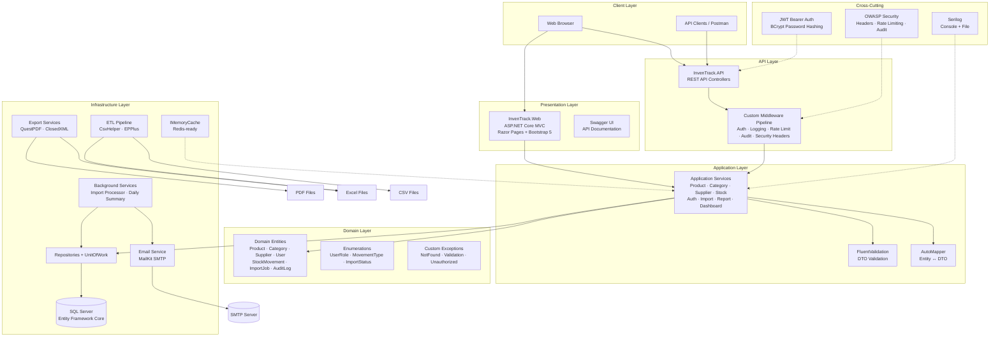

# InvenTrack Enterprise - Architecture Diagram

## High-Level Architecture



## Data Flow

### Request Flow (API)

```
HTTP Request → SecurityHeaders → RequestLogging → GlobalException → RateLimiting → JWT Auth → Controller → Service → Repository → Database
```

### Import Flow

```
Upload CSV/Excel → Validate File → Create ImportJob → Channel → BackgroundService → Parse Rows → Validate → Upsert Products → Update Job Status → Email Notification
```

## Database Schema

```
Users (1) ──< StockMovements (M)
Users (1) ──< ImportJobs (M)
Users (1) ──< AuditLogs (M)

Categories (1) ──< Products (M)
Suppliers (1) ──< Products (M)

Products (1) ──< StockMovements (M)
Products (1) ──< AlertLogs (M)
```
